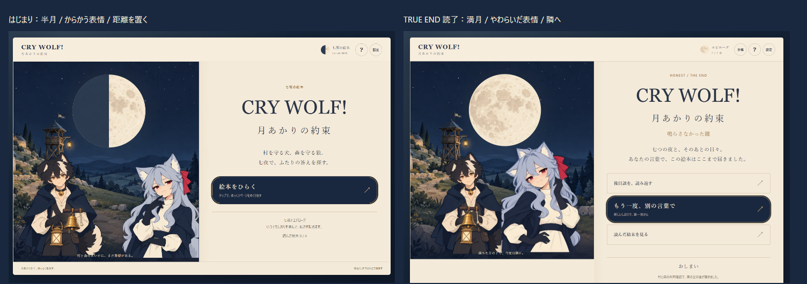

# はじまりと、約束の表紙 — v0.9.2追加調整

2026-10-15 JST。ユーザーの表情と月の指摘を受け、前コミット `d0ff0a9` から調整した。

満月になっていたのは `design-v092/title-reference.png` の生成見本。実装済みのホームは既に半月だった。見本もImagegenで半月と挑発的な小さな笑みへ直し、`title-reference-v2.png` として原本を残したまま保存。プロンプト・参照・SHA-256は [provenance-v2.json](design-v092/provenance-v2.json)。ゲームに見本の画像を焼き込んでいない。

ホームは既存 `luna-smirk.webp` の、目を少し細めたからかう表情へ変更。ベルに寄り添う配置を避け、二人の間の余白を広げる。親しい表情は既存 `luna-softened.webp` を使い、HONEST（TRUE END）の3ページの後日談を読み終えた `finish` に限って、同じ村と森・同じ月位置・同じタイトルの満月版の表紙を表示する。ベルも既存の微笑む差分となり、二人が隣へ近づく。

TRUE ENDの条件、4END、道の成立/不成立、保存と読了記録、七夜の月、台詞と後日談、3曲と音量は維持。完了済みのしおりからもこの満月版を再開できる。タイトルへ戻ると半月と最初の距離へ戻り、revision / events / history を増やさない。最後のBGMは「月夜」、タイトルに戻れば既存の「the fairy tale」。

| 実施確認 | 結果 |
| --- | --- |
| `npm test -- --reporter=dot` | 10ファイル、239/239 PASS。追加の判定テストは失敗を確認してから実装。HONEST読了のみ適用、ホーム/読了前/他ENDは対象外 |
| `npm run typecheck` / `npm run build` | PASS |
| `moon-cover-promise.js.txt` | 55/55 PASS。4画面サイズの開始/読了、半月/満月、表情、同じ背景、保存復帰、ホーム往復で履歴不変、後日談読み返し、他3ENDの保持 |
| `moon-seven-browser.js.txt` | 1,517/1,517 PASS。4ENDを七夜と後日談の最後まで実操作 |
| `moon-seven-production.js.txt` | 155/155 PASS。配布ビルド/直接HTML、道不成立、保存拒否など |
| `moon-import-audio.js.txt` | 59/59 PASS。実曲の再生・時間進行・3曲割当・音量・ミュート・直接HTML |

console/page errors: 0。原本と配布用37画像、`model.js`、`audio.js` は変更していない。対象サイズは360×800、390×844、720×1280、1440×900。追加55項目は合法な操作列から作ったしおりをQA専用ブラウザで再開して撮影。七夜の実クリック完走は別の1,517項目で実施。

[はじまり（360）](screenshots/cover-promise/opening-360.png) / [TRUE END読了（360）](screenshots/cover-promise/honest-360.png) / [はじまり（PC）](screenshots/cover-promise/opening-1440.png) / [TRUE END読了（PC）](screenshots/cover-promise/honest-1440.png)

[修正した生成見本](design-v092/title-reference-v2.png) / [見本と実装の同一入力比較](design-v092/comparison-v2.png)。ネイティブの360/1440px画像でも顔・文字・ボタンを開いて目視確認。見本の追加装飾は採用せず、現行の立ち絵・背景・端末標準フォントを優先した。

機械可読結果: `cover-promise-qa.json`、`cover-seven-qa.json`、`cover-production-qa.json`、`cover-audio-qa.json`。実機、Safari/Firefox、人間の感情移入と表情の印象、音の聴感は未確認。外部公開/pushなし。
