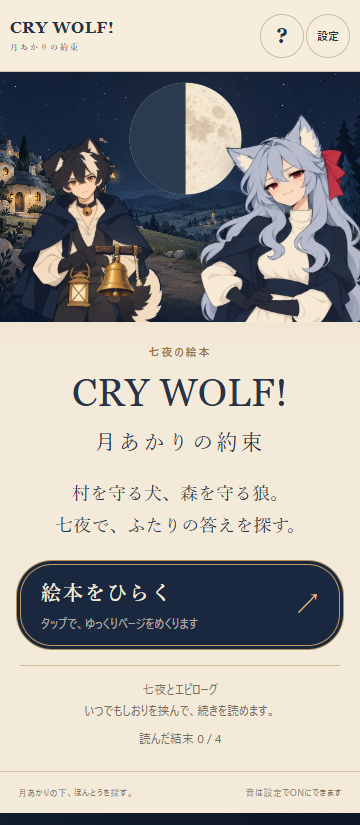
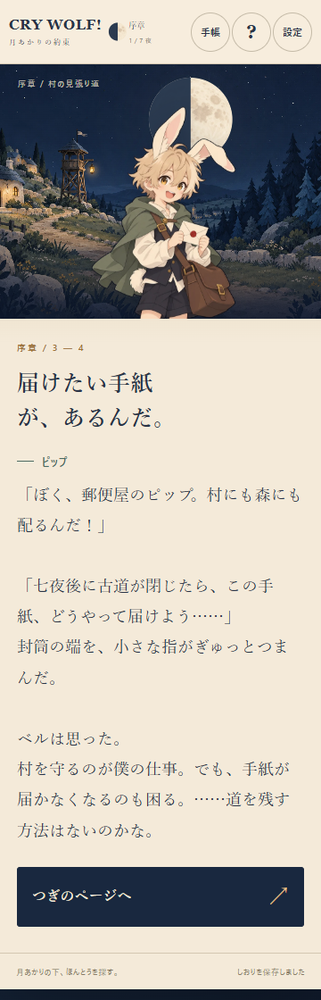
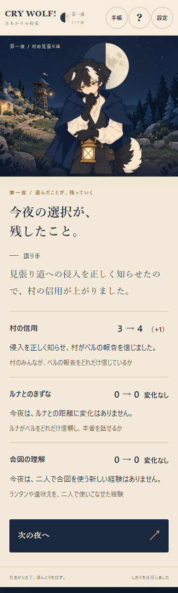
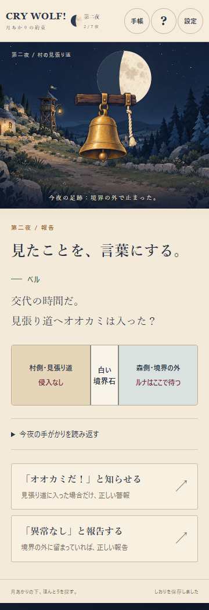
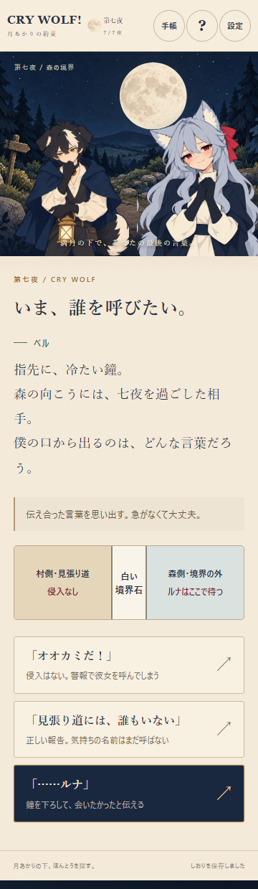

# 月あかりの約束 v0.9.2 — 仕上げと検証

実装・検証: 2026-10-14〜15 JST。作業開始時のローカル `main` とGitHub最新 `main` / HEADは、いずれも `64d59bf43435a39369287e13935454d0e2e687cc`。`git status --short` は空。`git ls-remote origin HEAD refs/heads/main` で照合してから `codex/moon-v092-finishing` で着手した。実装仕様はユーザー指定の [添付仕様の保存コピー](FINISHING_TASK_v0.9.2.md)。同梱AGENTS案は現行構成と照合した文案として扱った。

既存ホームを正式な表紙に変更。半月と村・森、まじめなベル、勝気なルナを既存素材で大きく見せ、短い紹介と主要ボタンを配置した。しおりがある場合は再開を先頭にし、完了済みのしおりでも読み直しに確認を挟む。読んだ結末は数だけを表示。

初期HTMLにローディングを置き、表紙の5画像と初期化だけを待つ。数値の進捗や固定待ちはない。音楽パックは非同期で、起動完了を妨げない。画像失敗時は再試行・画像なしで続行、スクリプト失敗時は再試行。動きOFFと端末設定を尊重し、読み込み中の本文リンクをTab対象にしない。

ピップの手紙の頁に、村を守る仕事と手紙の道を残したいベルの心の声を一文追加。第一夜の侵入の事実と翌朝の足跡は維持。第一夜の決断、第二・第五夜の報告では鐘を強調し、村側・白い境界石・森側を文字と位置でも区別。調査前の居場所は未確認として扱い、図の月もモデルの位相を使う。

ステータスの意味を常時併記し、手帳からも確認できる。反応の後の結果頁で、各項目の前後値・実差分・理由を読む。上限/下限で変化しない場合も説明。物語側の予定「＋1」などの文章を外し、実際の数値と矛盾する表示を避けた。`honesty` と合図の理解は混ぜない。

モデル、7夜/4ENDの条件、道の分岐、3ページの後日談、保存キーとv8移行、37点の画像、3曲と音量設定は保持。ルートAGENTSを七夜版の運用へ更新し、旧Reactとひと夜版は別実験と明記。

## 実施した検証

| 検証 | 実際の結果 |
| --- | --- |
| `npm test -- --reporter=dot` | 10ファイル、238/238 PASS。追加5件は実差分/クランプ/未知の居場所/決断表示。失敗を先に確認して実装した |
| `npm run typecheck` / `npm run build` | 両方PASS、静的 `dist/moon/` 生成 |
| `moon-seven-browser.js.txt` | 1,517/1,517 PASS、4ENDを七夜と後日談の最後まで実操作。保存、v8移行、手帳、読み返し、動きOFF、文字/画像/44px操作対象 |
| `moon-import-audio.js.txt` | 59/59 PASS。実曲のデコードと再生時間進行、場面別3曲、音量保存、ミュート、ループ、同曲継続、操作前無音、直接HTMLの音 |
| `moon-v092-recovery.js.txt` | 30/30 PASS。画像保留/失敗、アプリ失敗と再試行、画像なし再開、音楽パック遅延、進行不変、途中/完了済みしおりの再読確認、END履歴の保持、Escape、ロード中Tab、しおり復帰 |
| `moon-seven-production.js.txt` | 155/155 PASS。配布ビルドと直接 `file://` で七夜完走、道不成立の後日談、保存拒否、文字拡大、外部実行資源なし |
| モデル探索（Vitest内） | 17,085判断状態、139,465遷移、93,248ページ検査。4END×道の成否の8種類すべて到達。将来の判定に必要な事実で状態統合する探索 |
| 画面比較とレビュー | [design-qa.md](../../design-qa.md) `passed`。720pxの鐘位置とロード中Tabの指摘を修正して再確認 |

成功経路のconsole/page errorは0。失敗QAの通信遮断は意図的で、予期しないJavaScript errorは0。最初のブラウザ確認では非表示の手帳ボタンを小さな操作対象と数える検査側の4件が出たため、表示中の対象だけを測るよう修正して再実行した。失敗をPASS扱いにはしていない。

再現例: `npx --no-install --package @playwright/cli playwright-cli -s=<独立QAセッション> run-code --filename scripts/qa/moon-v092-recovery.js.txt`。devは5198、productionは5199。機械可読の結果は `v092-seven-browser-qa.json` / `v092-audio-qa.json` / `v092-recovery-qa.json` / `v092-production-qa.json`。

| END | 第一〜三夜の経路 | 第四〜七夜の経路 | 観測した道 |
| --- | --- | --- | --- |
| HONEST | ring1, track2, signal2, silent2, forest3, speak3, signal3, proposal3 | thank4, want5, track5, signal5, silent5, village6, forest6, heart6, plan6, call7 | 成立（配布確認ではhush6を選び不成立も確認） |
| SECRET_MEETING | HONESTと同じ前半 | thank4, want5, track5, signal5, silent5, wait6×3, hush6, silent7 | 不成立 |
| GOOD_DOG | ring1, track2×2, ring2, forest3, speak3, signal3, facts3 | pocket4, away5, track5, listen5, silent5, survey6, village6, forest6, plan6, ring7 | 成立 |
| BAD_LIAR | hide1, track2×2, silent2, village3, speak3, signal3, false3 | ring4, decide5, track5, listen5, silent5, wait6×3, hush6, silent7 | 不成立 |

## 指定5場面のスクリーンショット

360×800、390×844、720×1280、1440×900で各5場面のbefore/afterを保存。以下は360px版。縦長の読書頁は全ページ撮影で、自然なスクロールを含む。撮影は合法なモデル操作から作ったしおりを独立QAブラウザに入れ、実際の再開ボタンを押した。全七夜の実操作確認は上の別スイートで実施。

| 場面 | 改修前 | 改修後 |
| --- | --- | --- |
| タイトル | [before](screenshots/v092/before-title-360.png) | [after](screenshots/v092/after-title-360.png) |
| 序章・ピップの手紙 | [before](screenshots/v092/before-prologue-360.png) | [after](screenshots/v092/after-prologue-360.png) |
| 第一夜の結果・理由 | [before](screenshots/v092/before-night1-result-360.png) | [after](screenshots/v092/after-night1-result-360.png) |
| 第二夜の境界・報告 | [before](screenshots/v092/before-night2-boundary-360.png) | [after](screenshots/v092/after-night2-boundary-360.png) |
| 最終夜・満月 | [before](screenshots/v092/before-night7-final-360.png) | [after](screenshots/v092/after-night7-final-360.png) |

[ロード画面](screenshots/v092/loading-360.png)、[失敗時の復帰](screenshots/v092/loading-failure-360.png)、[生成見本と実装の比較](design-v092/comparison.png)。Imagegenは構図見本のみで、ゲーム画像への置き換えはしていない。正確なプロンプト/入力/出力ハッシュは [制作記録](design-v092/provenance.json)。

音の条件は公式 [OpenTracksライセンス](https://opentracks.com/help/articles/license/) と [利用規約](https://opentracks.com/help/articles/terms/)、[the fairy tale](https://opentracks.com/bgm/detail/19133)、[Storytellerの公式ページ](https://opentracks.com/bgm/detail/21959/download)、[月夜](https://opentracks.com/bgm/detail/6987)を参照した。BGMとしての使用/加工例と、音源単独配布・容易に音声ファイルへアクセスできる形を避ける条件を再確認。新しい音源の収集、原音の変更、音源コンテナの作り直しは行っていない。これは権利者からの個別許諾や法的保証を取得したという意味ではない。

## 未実施と次の人間試遊

Android/iOS実機、Safari/Firefox、スクリーンリーダー利用者、実機の非表示/復帰、聴感の音量/継ぎ目、初見の感情移入と面白さは未確認。機械PASSと区別する。

人間試遊では、序章後に「ベルの仕事」「道が閉じると困る理由」、第一夜後に「信用ときずなの意味・変わった理由」、第二夜に「どちら側で警報が必要か」、最後に「満月の意味と音楽の切り替え」を本人の言葉で聞く。[添付仕様](FINISHING_TASK_v0.9.2.md)の質問一覧も利用できる。

外部公開・push・デプロイは行わない。ローカルプレビューは `http://127.0.0.1:5198/moon/index.html`。
